<div align="center">

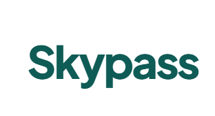

# Skypass
### Search a flight, choose every seat, and watch your boarding pass print

[](https://kotlinlang.org/)
[](https://developer.android.com/)
[](https://developer.android.com/jetpack/compose)
[](https://supabase.com/)
[](https://dagger.dev/hilt/)
[](#architecture)
[](#tests)

<br />

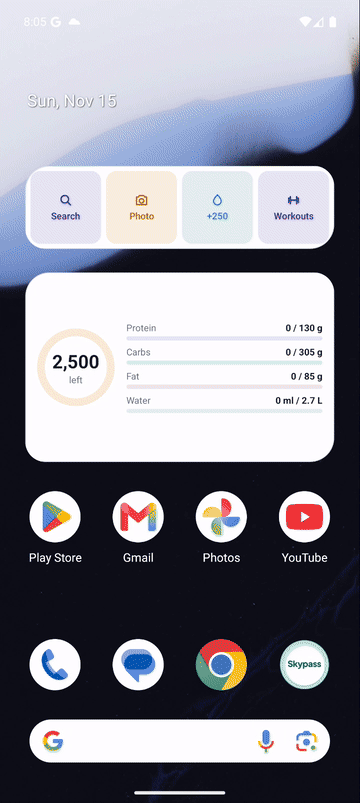

</div>

---

## Overview

**Skypass** is a native Android flight-booking app, built with Kotlin and Jetpack Compose by [AhmadALSaffan](https://github.com/AhmadALSaffan). A traveller searches a real-looking global network, compares results laid out as boarding passes, fills in their passport details, picks a seat on a full aircraft map, pays, and watches the boarding pass **print out of a printer** on screen.

Everything behind it runs on **Supabase**:

- a year of departures (924,000 flights across 110 airports and 48 airlines);
- seat maps generated per aircraft;
- prices, promo codes and bookings computed on the server;
- row-level security on everything a traveller owns.

The app is split into feature and core modules, follows **MVVM** with use cases and small repository interfaces (**SOLID**), and has a light and a dark theme.

---

## Screenshots

Every screen below is shown in **light** and **dark**. The phone picks the theme.

### First run: an animated onboarding

Each page is a short scene played in Compose, not a video. A route draws itself and a boarding pass drops onto it. A result unfolds into a ticket, with its barcode scanning and its price counting up. Then a gate-change alert lands on a phone that's offline.

| | Find flights | Every result is a pass | In your pocket | Sign in |
|:---:|:---:|:---:|:---:|:---:|
| **Light** |  | 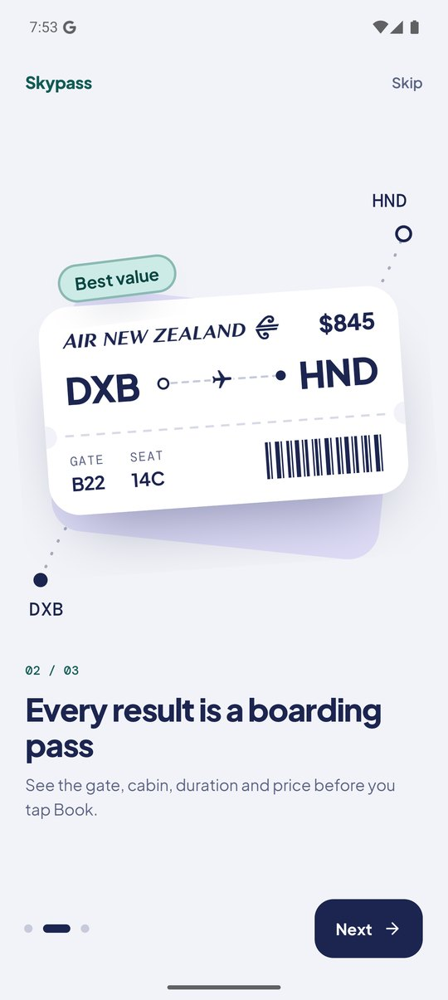 |  | 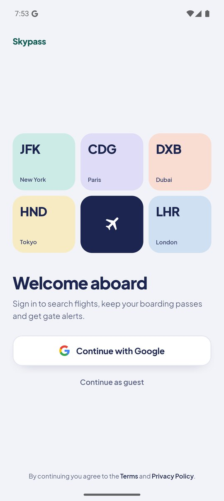 |
| **Dark** | 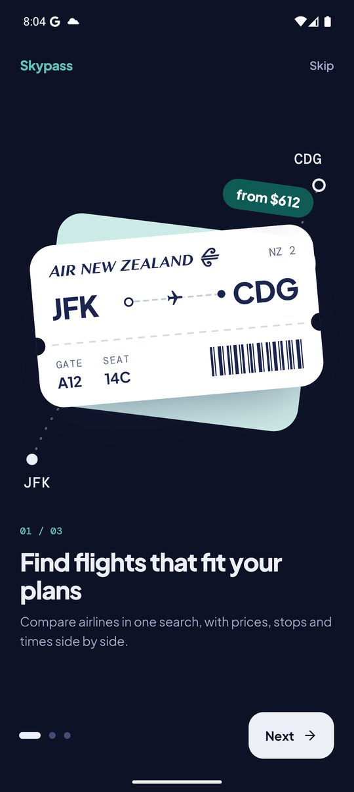 |  | 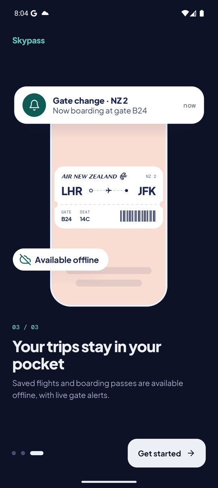 | 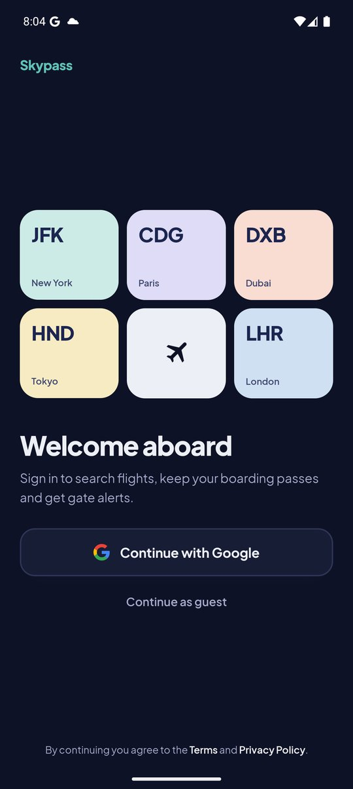 |

### Search

| | Home | Your next trip | Results |
|:---:|:---:|:---:|:---:|
| **Light** | 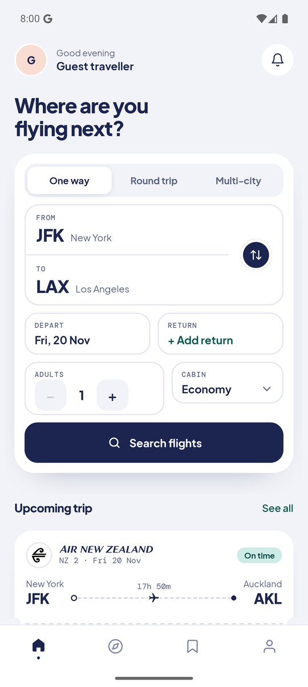 |  |  |
| **Dark** | 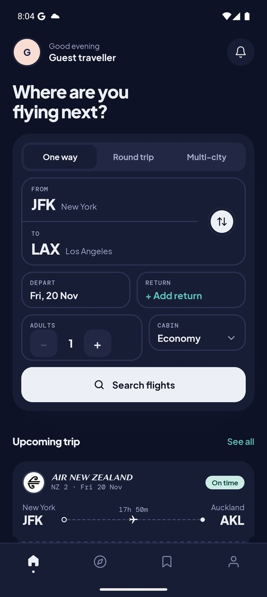 | 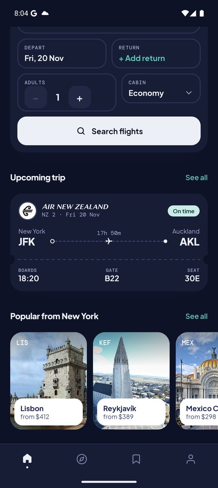 | 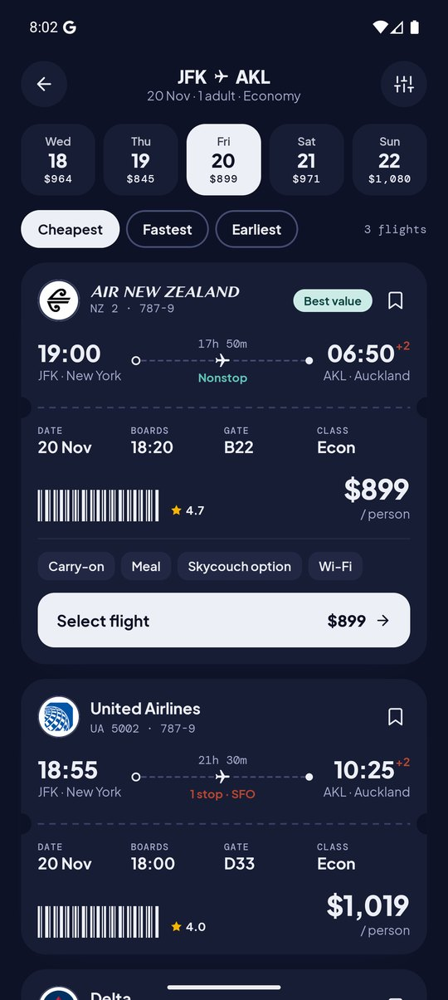 |

### Book

| | Seat map | Passenger details | Payment |
|:---:|:---:|:---:|:---:|
| **Light** |  |  | 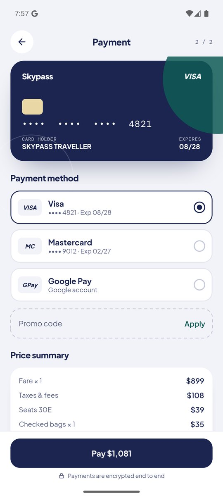 |
| **Dark** | 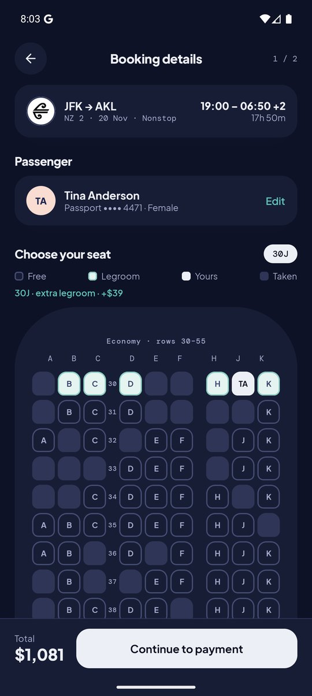 |  |  |

### The boarding pass prints

After payment, a printer slot slides in and the pass feeds out of it line by line, with a haptic tick on each step. When it's done, the pass tears free with a spring. Then you can add it to Google Wallet or share it.

<div align="center">

</div>

| | Printing | Your boarding pass |
|:---:|:---:|:---:|
| **Light** |  |  |
| **Dark** | 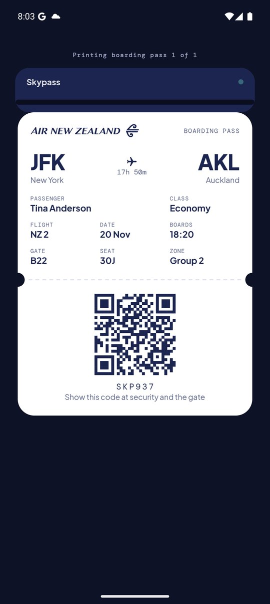 | 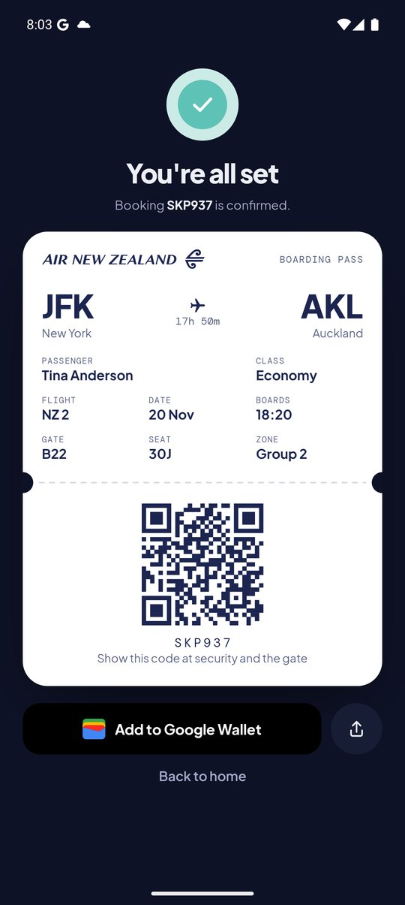 |

### Explore

The tiles, the deal and the photo grid are for inspiration. Tapping a destination, an airport or the deal fills Home's search card and switches to it.

<div align="center">
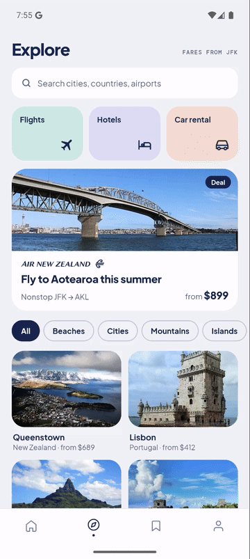
</div>

| | Explore | A category | Search |
|:---:|:---:|:---:|:---:|
| **Light** |  | 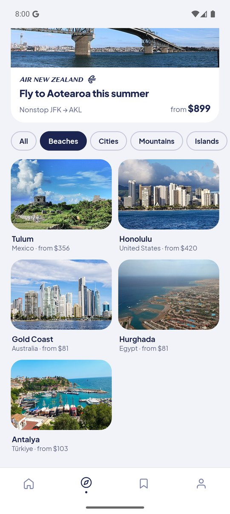 | 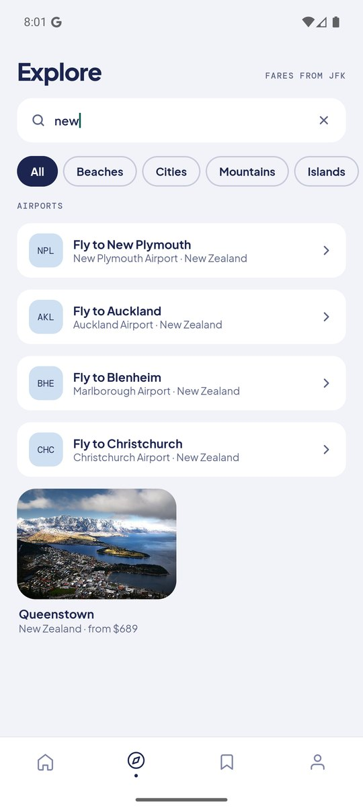 |
| **Dark** | 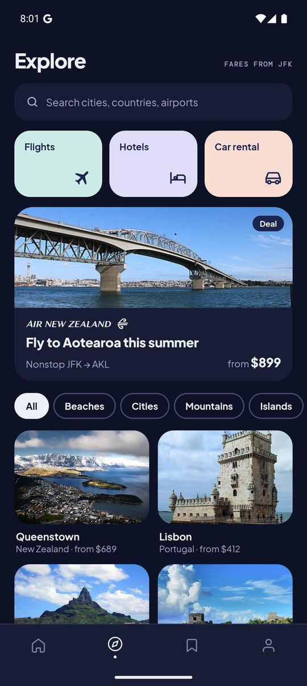 | 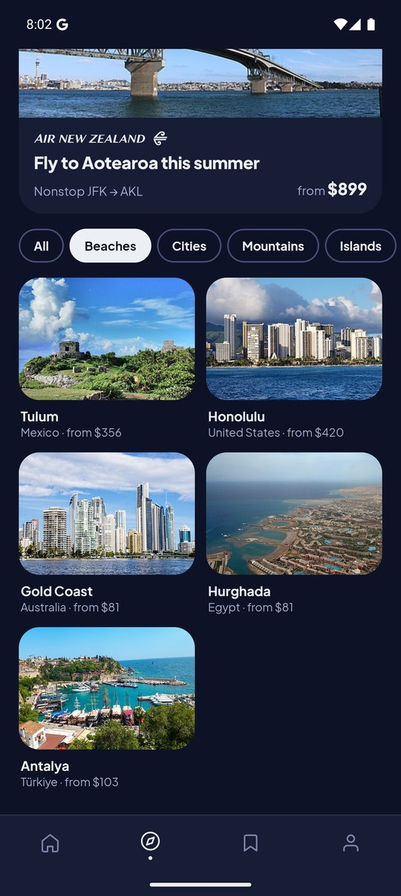 | 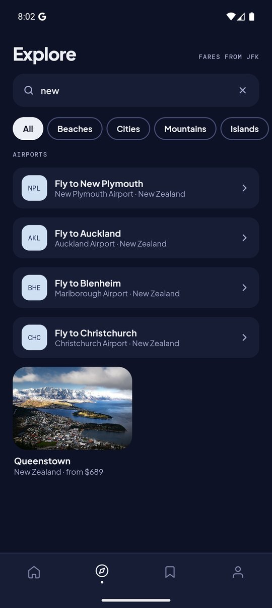 |

---

## Features

- 🎬 **Animated onboarding**: three scenes driven by one timeline per page (`rememberTimeline`, `appear`, `pop`, `rise`, `typed`). A page replays when it becomes active. Previews and reduced motion jump to the final frame.
- 🔐 **Sign in**: Google through Credential Manager, exchanged for a Supabase session (ID token + nonce), or continue as a guest (anonymous sign-in).
- 🏠 **Home**:
  - **From** is the airport nearest to you, if you allow location.
  - The swap button turns half a turn.
  - Pick an airport from a searchable sheet and dates from a calendar.
  - **+ Add return** opens the calendar; it never guesses a date.
  - Cabin is a dropdown.
  - Your next trip shows a live gate and status through Supabase Realtime.
  - Popular destinations from your airport, with photos.
- ✈️ **Takeoff**: the search icon turns into a plane, grows, and flies across the screen while the results slide in.
- 🎫 **Results as boarding passes**:
  - A five-day price strip.
  - Cheapest, Fastest and Earliest sorting, each a strategy class.
  - Filters for stops, airlines and departure time.
  - Airline logos, a "Best value" pill, and saving a flight.
  - Cards expand to show perks and the price for everyone travelling.
- 💺 **The whole aircraft**: the server builds the seat map from the aircraft type (3-3, 3-4-3, 2-4-2 and more), with legroom rows and seats taken. Every traveller gets a seat; you start with seats side by side, and tapping a fellow traveller's seat swaps you.
- 🛂 **Passport details**: all nine fields the airline needs: first and last name, gender, passport type, number, issue and expiry date, phone and email. They're checked as you type: an expiry before the trip, or within six months of it, is flagged.
- 💳 **Payment**:
  - The card preview flips when you change method.
  - Promo codes are validated on the server.
  - The price summary and the total animate as they change.
  - Paying is idempotent: a retry after a network error reuses the same booking, so nothing is charged twice.
- 🖨️ **Boarding pass**: printed on screen, then shown with a real QR code (zxing) of the PNR at full brightness. **Add to Google Wallet** carries the official mark (issuing a real pass needs a Wallet issuer account), and you can share the pass.
- 🧭 **Explore**:
  - Service tiles for Flights, Hotels and Car rental.
  - A fare deal with its photo.
  - Category chips and a two-column photo grid, priced from your own airport.
  - Search covers cities, countries and airports.
  - The search and the chosen chip survive process death.
- 🌗 **Light and dark**: every screen, from the same design tokens.
- ♿ **Every state designed**: loading skeletons, empty, offline and error states with retry.

---

## Architecture

```text
:app ──► :feature:*  ──► :core:domain ◄── :core:data ──► :core:network (supabase-kt)
              │               ▲                 │
              ▼               │                 └──► :core:datastore
      :core:designsystem   :core:model
```

- **MVVM, one direction.** Each screen is a `XRoute` (collects state and one-off effects, gets its ViewModel from Hilt), then a stateless `XScreen(uiState, onEvent)`, then a `XViewModel` holding a `StateFlow` of UI state, a sealed `Event` and a `Channel` of `Effect`s.
- **Single responsibility.** One use case per action: `SearchFlightsUseCase`, `CalculateBookingTotalUseCase`, `ValidatePassengerUseCase`, `PayForTripUseCase`, `GetExploreCatalogUseCase` and more. ViewModels only map state.
- **Open/closed.** Sorting is a `FlightSortStrategy`. The price is a chain of `PriceRule`s (fare, promo, tax, seat fee, bags). A new rule is a new class.
- **Interface segregation.** Small repositories: `FlightSearchRepository`, `SeatMapRepository`, `PassengerRepository`, `BookingRepository`, `ExploreRepository`, `SearchIntentRepository` and more. There's no "god" repository.
- **Dependency inversion.** Features see interfaces from `:core:domain` only; Hilt binds the Supabase implementations in `:core:data`. Fakes in `:core:testing` replace them in tests.
- **Server as the source of truth.** Prices, seat holds, promo codes and the PNR are computed in Postgres functions. The app shows the same numbers.

### Backend (Supabase)

| | |
|---|---|
| Tables | `airports`, `airlines`, `routes`, `flights`, `flight_instances`, `cabin_layouts`, `destinations`, `deals`, `promo_codes`, `profiles`, `passengers`, `bookings`, `booking_passengers`, `booking_seats`, `saved_items`, `hotels`, `cars`, `rental_reservations`, `user_settings` |
| Functions | `search_flights`, `date_price_strip`, `flight_offer`, `get_seat_map`, `create_booking`, `pay_booking`, `check_promo`, `boarding_pass`, `next_trip`, `explore_destinations` |
| Security | Row-level security on every user table; catalogue tables are read-only; functions run with a fixed `search_path` |
| Realtime | `flight_instances` updates, for live gate and status changes |
| Data | 924,067 departures from 2026-11-15 to 2027-11-15, generated in SQL from a compact route list |

---

## Tech Stack

| Layer | Technology |
|---|---|
| Language | Kotlin 2.3 |
| UI | Jetpack Compose (BOM 2026.02), Material 3, type-safe Navigation Compose |
| Motion | Timeline-driven Compose animation, `Animatable`, springs, `graphicsLayer` |
| DI | Hilt + KSP |
| Backend | Supabase: Auth (Google ID token, anonymous), Postgrest, Realtime, Storage, via supabase-kt 3.6 on Ktor (OkHttp) |
| Sign-in | Credential Manager + Google ID |
| Images | Coil 3 |
| QR codes | zxing core |
| Local storage | DataStore |
| Build | Gradle convention plugins (`build-logic`), version catalog, AGP 9.5 |
| Tests | JUnit 5, Turbine, kotlinx-coroutines-test, fakes |
| CI | GitHub Actions: unit tests and a debug build on every push |
| Min / target SDK | 26 / 37 |

---

## Getting Started

### Prerequisites

- Android Studio (a recent stable release), JDK 21
- A Supabase project (the free plan is enough)
- A Google Cloud OAuth client (Web application) for Google sign-in

### 1. Clone

```bash
git clone https://github.com/AhmadALSaffan/skypass.git
cd skypass
```

### 2. Database

Apply the migrations in `supabase/migrations/`, in order, with the Supabase CLI:

```bash
supabase link --project-ref <your-project-ref>
supabase db push
```

Migration 7 generates a year of departures, so it can take a while.

### 3. Auth

In the Supabase dashboard, under **Authentication → Sign In / Providers**:

- turn on **Google** with your Web client ID and secret;
- turn on **Allow anonymous sign-ins** for "Continue as guest".

Add your debug keystore's SHA-1 to an **Android** OAuth client in the same Google Cloud project.

### 4. Keys in `local.properties` (git-ignored)

```properties
supabase.url=https://your-project.supabase.co
supabase.key=sb_publishable_...
google.webClientId=1234567890-xxxx.apps.googleusercontent.com
```

### 5. Build and run

```bash
./gradlew :app:installDebug
```

<a id="tests"></a>
### Tests

```bash
./gradlew testDebugUnitTest test
```

The tests cover the ViewModels (with Turbine), the use cases, the price rules, the sort strategies and passport validation. The promo-code maths is checked against the server's own figure.

---

## Project Structure

```text
app/                    MainActivity, navigation host, the takeoff overlay, Coil setup
build-logic/            convention plugins (application, library, feature, compose, hilt)
core/
├── model/              plain Kotlin models (Flight, Seat, Passenger, Booking, Destination…)
├── domain/             repository interfaces and use cases (pure Kotlin)
├── data/               Supabase repositories, DTOs, Hilt bindings
├── network/            the Supabase client
├── auth/               Google sign-in with Credential Manager
├── datastore/          onboarding and preferences
├── designsystem/       theme, tokens, motion, ticket shapes, icons, components
└── testing/            fakes and test data
feature/
├── onboarding/         the three animated scenes
├── auth/               sign in
├── home/               search card, pickers, next trip, popular destinations
├── results/            boarding-pass results, price strip, filters
├── booking/            passengers and the seat map
├── payment/            methods, promo code, pay
├── confirmation/       the printer and the boarding pass
└── explore/            tiles, deal, categories, destination grid
supabase/migrations/    schema, functions, security, seed data
docs/                   screenshots and GIFs for this README
```

---

## Contributing

Pull requests are welcome. For major changes, please open an issue first.

1. Fork the repo
2. Create your feature branch: `git checkout -b feature/your-feature`
3. Commit your changes: `git commit -m "feat: add your feature"`
4. Push the branch: `git push origin feature/your-feature`
5. Open a Pull Request

---

## Credits

- Destination photos come from [Wikimedia Commons](https://commons.wikimedia.org/), each under its own Creative Commons licence; the author and licence are on each file's page.
- Airline logos are loaded from Kiwi.com's public image CDN and belong to their airlines.
- Air New Zealand's name, wordmark and koru belong to Air New Zealand. This is a non-commercial portfolio project and isn't affiliated with or endorsed by Air New Zealand.
- The Google Wallet mark follows Google's brand guidelines.

---

<div align="center">
  Built with ❤️ by <a href="https://github.com/AhmadALSaffan">Ahmad AlSaffan</a>
</div>
